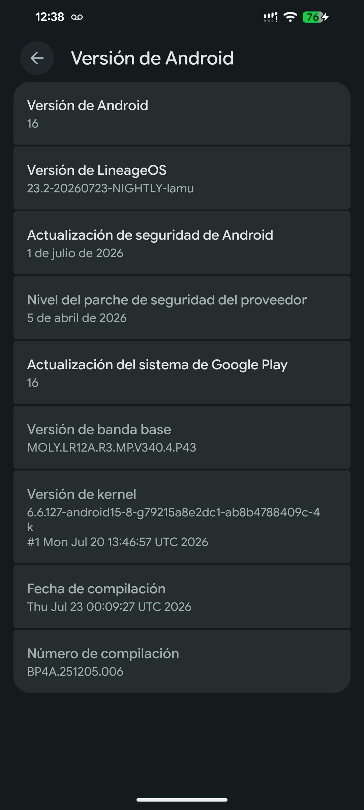
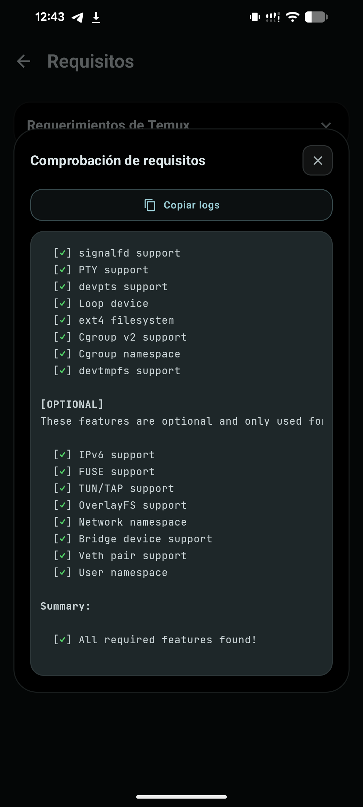
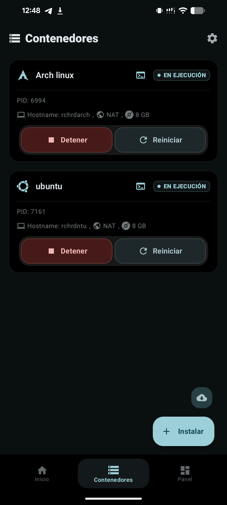

# Moto G15 (lamu) — Custom Kernel para DroidSpaces

Custom kernel (GKI) para el **Motorola Moto G15** (`lamu`, MediaTek, kernel tree `kernel-6.6`) que habilita las funciones de **DroidSpaces** en Android: **chroot nativo**, **Docker nativo**, mejor rendimiento, etc.

Basado en LineageOS 23.2 (`android_kernel_motorola_lamu_manifest`, rama `lineage-23.2`) y compilado con la toolchain oficial de Android (Clang/Bazel Kleaf).

## Releases

| Release | Archivo | Descripción |
|---|---|---|
| v1.0 | `boot-lamu-custom.img` (descargable desde la pestaña **Releases** de GitHub) | Boot image flasheable (header v4, GKI) con el kernel custom |

### Características del kernel (GKI-Exclusive de la doc de Droidspaces)

Alternativas habilitadas en `gki_defconfig`:

- `CONFIG_SYSVIPC=y`
- `CONFIG_POSIX_MQUEUE=y`
- `CONFIG_IPC_NS=y`
- `CONFIG_PID_NS=y`
- `CONFIG_DEVTMPFS=y`
- `CONFIG_NETFILTER_XT_MATCH_ADDRTYPE=y`

Opciones de Docker Swarm (`VXLAN`, `IP_VS`, `IP_VS_RR`, `BRIDGE_NETFILTER`) **revertidas**: no presentes en la doc de Droidspaces y arriesgan kABI.

> **Nota kABI:** en kernels < 6.12, habilitar `CONFIG_SYSVIPC`/`CONFIG_IPC_NS` desplaza offsets de `task_struct` y puede bootlooper si se rompe la kABI. Por eso se aplica el parche oficial `001.GKI-below-6.12-fix_sysvipc_kabi_6_7_8.patch` (ver notebook).

## Version del kernel compilado

```
Linux version 6.6.127-android15-8-g98e7be363fe2-dirty-4k
#1 SMP PREEMPT Fri Aug  7 01:33:44 UTC 2026
```

El hash `98e7be363` identifica de forma única la config de este build (se puede verificar después de flashear vía `uname`/pstore).

## Capturas

Kernel custom visible en Configuración del dispositivo:



Requisitos de DroidSpaces verificados, todos en verde:



Contenedores de Droidspaces corriendo:



## Instalación

### Requisitos
- Bootloader desbloqueado.
- LineageOS 23.2 (o ROM compatible con GKI de este dispositivo) instalada.
- `fastboot` en la PC.

### Flashear

```bash
# Opción A: recovery/instalador (añadir a una ROM zip)
# Opción B: fastboot (necesarias particiones boot)
fastboot flash boot boot-lamu-custom.img
fastboot reboot
```

> Solo reemplaza la imagen `boot`. El ramdisk real vive en `vendor_boot.img` (ramdisk size 0, normal en GKI de este dispositivo).

## Compilar desde cero

1. Sincronizar el árbol:
   ```bash
   mkdir -p ~/lamu-kernel && cd ~/lamu-kernel
   yes | repo init -u https://github.com/moto-mediatek-devs/android_kernel_motorola_lamu_manifest -b lineage-23.2 --depth=1
   repo sync -c -j24 --force-sync --no-clone-bundle --optimized-fetch
   ```
2. Aplicar el parche kABI (`001.GKI-below-6.12-fix_sysvipc_kabi_6_7_8.patch`) en `kernel-6.6`.
3. Aplicar los cambios de `gki_defconfig` (ver notebook `kernel_droidspaces_lamu_clear.ipynb`).
4. Compilar:
   ```bash
   ./build_mgk_64_k66.sh
   ```
5. Empaquetar boot.img con las herramientas de mkbootimg:
   - Descargar el boot.img stock de LineageOS (`boot.img`, 64 MB).
   - `unpack_bootimg.py` → sustituir `kernel` por `out/mgk_64_k66/dist/Image.gz`.
   - `mkbootimg.py --header_version 4` + `avbtool add_hash_footer --partition_name boot --algorithm NONE`.
6. Verificar que los hashes del kernel dentro del boot.img coincidan con los del build (`sha1sum verify/kernel out/mgk_64_k66/dist/Image.gz`).

El paso a paso completo está documentado en [`kernel_droidspaces_lamu_clear.ipynb`](kernel_droidspaces_lamu_clear.ipynb).

## Problema conocido: el touch no responde al encender la pantalla (pantallas de repuesto)

**Síntoma:** después de encender la pantalla, a veces el touch no responde en absoluto. Nunca deja de funcionar con la pantalla encendida. Apagar y encender la pantalla (a veces varias veces) lo recupera.

**A quién afecta:** unidades con pantalla de repuesto/reacondicionada cuyo chip touch es un **ILITEK ILI9883** (`/proc/ilitek/ver_info` → `CHIP ID = 9883`), pero que el kernel maneja con el driver de panel **BOE ICNL9922C** (`boe_prepare boe icnl9922c` en `dmesg`). No es un problema de este kernel custom: se reproduce igual con el kernel oficial de LineageOS 23.2. Con la ROM stock de Motorola no se recuerda haberlo visto.

**Causa** (diagnosticada con `dmesg` y el contador de interrupciones del touch en `/proc/interrupts`):

1. Al apagar la pantalla, `boe_unprepare` corta la energía del panel. Como es un TDDI (pantalla y touch en el mismo chip), el touch **pierde su firmware**, que vive en RAM (IRAM) y no en flash.
2. Al encender, el driver `tp_ilitek` solo reactiva la interrupción (`Sleep Mode = 2`). No resetea el chip ni recarga el firmware: asume que el driver del panel se encargó, cosa que el driver BOE no hace.
3. El touch solo revive **por accidente**: si llega una interrupción espuria justo después del resume, la lectura falla (`spi-wrapper read error`, PC del chip = `0x0`) y eso dispara `ili_spi_recovery` → reset → recarga de firmware → `FW upgrade pass` (~160 ms después del resume).
4. Si esa interrupción llega antes de tiempo, el driver la ignora (`ignore interrupt !`), no hay recuperación y el touch queda muerto hasta el siguiente ciclo de pantalla.

En una prueba de 10 ciclos de apagado/encendido deslizando el dedo sin parar, el touch quedó muerto en 4: 1 interrupción en 6 s, contra 50–85 en los ciclos buenos. `FW upgrade pass` apareció en **todos** los ciclos buenos y en **ninguno** de los malos.

**Parche temporal:** [`tools/touchfix.sh`](tools/touchfix.sh) vigila `dmesg`. Si tras encender la pantalla no aparece `FW upgrade pass` en 0,5 s, fuerza la recuperación:

1. **Sin parpadeo**, con el módulo [`tools/ilitek_kick`](tools/ilitek_kick): simula la interrupción del touch con `generic_handle_irq_safe()`, y el driver ejecuta su propia recuperación (reset + recarga de firmware) igual que en un ciclo bueno. Tarda ~135 ms.
2. **Respaldo**, si no hay módulo o 2 interrupciones simuladas no bastaron: apaga y enciende la pantalla (hasta 8 reintentos en total).

Resultados en 10 ciclos de apagado/encendido: sin parche, 4 ciclos con el touch muerto; solo con apagar/encender, 10 de 10 con touch pero con parpadeos (a veces 4 seguidos); con el módulo, 10 de 10 con touch y sin parpadeos (los 4 ciclos malos se resolvieron con una sola interrupción simulada). Requiere root y deja un log en `/data/local/tmp/touchfix/touchfix.log`.

### Compilar el módulo

El módulo no importa ningún símbolo del kernel: así no depende de los CRC de `MODVERSIONS`. `touchfix.sh` le pasa la dirección de `generic_handle_irq_safe` al cargarlo, leída de `/proc/kallsyms`. Aun así, debe compilarse para el kernel exacto del teléfono. [`build.sh`](tools/ilitek_kick/build.sh) lo hace automáticamente con el teléfono conectado por `adb` y root para "Shell":

- Lee la versión del kernel (`uname -r`) y baja de AOSP solo la parte del árbol de ese commit necesaria para módulos externos, a `~/.cache/lamu-kmod`.
- Usa la config real del teléfono (`/proc/config.gz`) y el CRC de `module_layout` de `tp_ilitek.ko`.
- Compila y verifica que `struct module` coincida con la de los módulos del teléfono.

```bash
tools/ilitek_kick/build.sh   # requiere clang, ld.lld y llvm-objcopy en la PC
```

Hay que recompilarlo si cambia el kernel (actualización de LineageOS o kernel custom). Si no coincide, el kernel simplemente lo rechaza y `touchfix.sh` sigue funcionando con apagar/encender.

### Instalar

Para que arranque solo con KernelSU o Magisk (requiere dar root a "Shell" en el gestor):

```bash
adb push tools/touchfix.sh tools/ilitek_kick/ilitek_kick.ko /data/local/tmp/
adb shell
su
```

Y dentro de la sesión `su` del teléfono:

```sh
pkill -f /data/adb/touchfix/touchfix.sh   # si ya había una versión corriendo
mkdir -p /data/adb/touchfix /data/adb/service.d
cp /data/local/tmp/touchfix.sh /data/local/tmp/ilitek_kick.ko /data/adb/touchfix/
rm /data/local/tmp/touchfix.sh /data/local/tmp/ilitek_kick.ko
printf '#!/system/bin/sh\nsetsid /data/adb/touchfix/touchfix.sh >/dev/null 2>&1 </dev/null &\n' > /data/adb/service.d/touchfix.sh
chmod 755 /data/adb/touchfix /data/adb/service.d /data/adb/touchfix/touchfix.sh /data/adb/service.d/touchfix.sh
chmod 644 /data/adb/touchfix/ilitek_kick.ko
restorecon -R /data/adb/touchfix /data/adb/service.d
sh /data/adb/service.d/touchfix.sh   # lanzarlo ya, sin esperar al reinicio
```

> Ojo con `adb shell su -c '...; ...'` desde la PC: la shell local se come las comillas y solo el primer comando corre como root.

**Qué no hacer** (lecciones del diagnóstico):

- No leer `/proc/ilitek/fw_upgrade` ni `/proc/ilitek/fw_pc_counter`: el primero dispara una recarga de firmware y el segundo pone el chip en modo ICE. Ambos pueden dejar el touch muerto hasta reiniciar (no hay daño permanente).
- `unbind`/`bind` del driver `ILITEK_TDDI` tampoco sirve: recarga el firmware, pero el driver no libera sus GPIO al desconectarse y no logra registrar la interrupción (`Request IRQ GPIO failed, ret = -16`).

**Solución de fondo (pendiente):** en el kernel, hacer siempre reset + recarga de firmware en el resume de `tp_ilitek`, o que el panel de repuesto se maneje con el driver de panel correcto. Pendiente de reportar al mantenedor de LineageOS para `lamu`.

## Advertencia

- Flashear un kernel custom puede romper la kABI de tu ROM si no es compatible. Usa este build con LineageOS 23.2 para `lamu`.
- Esto es un proyecto de desarrollo; úsalo bajo tu propio riesgo.